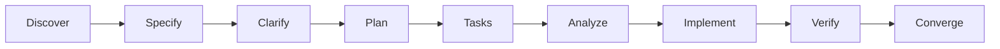

# CraftRail

**Guardrails for agent-driven development.**

CraftRail is a Git-native, agent-neutral framework for keeping engineering intent, architecture, and verification aligned across human and AI-assisted development. It gives a project a shared place for requirements, decisions, contracts, feature plans, and evidence without requiring a hosted service or a particular coding agent.

> The framework owns the engineering process. The coding agent is replaceable.

## Why use it

Coding agents can work from a repository, but chat context is temporary. CraftRail keeps product intent and engineering constraints reviewable beside code, then connects requirements to acceptance criteria, tasks, and verification evidence. It is designed for individual engineers, technical leads, staff/principal engineers, and small teams.

CraftRail provides reusable project structure and templates, stable requirement IDs, architecture and ADR conventions, agent-neutral workflow prompts, and a Python standard-library validator. It does not guarantee agent correctness, replace tests or review, prescribe a language or architecture, or require a particular delivery methodology.

## Product philosophy

- Human intent before generated code.
- Specifications before implementation.
- Architecture before uncontrolled complexity.
- Verification before declaring completion.
- Documentation that evolves with the code.

## The three layers

| Layer | Owns | Canonical formats |
|---|---|---|
| Core | Requirements, architecture, decisions, contracts, traceability, validation | Markdown, Mermaid, YAML, JSON |
| Workflow | Discover, Specify, Clarify, Plan, Tasks, Analyze, Implement, Verify, Converge | Markdown guidance and prompts |
| Adapters | Agent-specific instruction discovery and optional integrations | Minimal pointers/configuration only |

`AGENTS.md` is the shared canonical instruction file. `CLAUDE.md` imports it using Claude Code's documented import syntax. OpenCode reads `AGENTS.md` directly; it does not use `CLAUDE.md` as a fallback. No core artifact or tool requires an AI provider. See the [compatibility matrix](docs/framework/agent-compatibility.md).

## Workflow



These are quality gates, not nine required meetings. Combine or skip steps for low-risk changes when intent remains clear; use the full path for high-impact work.

## Quickstart: start a project

Use **Use this template** on GitHub after the owner publishes this repository, or clone it locally. Replace the illustrative project files in `docs/project/`, review the engineering principles, add project requirements and architecture, and retain or adapt `AGENTS.md`. See [GitHub template usage](docs/framework/github-template-usage.md).

Create a feature and validate locally:

```bash
python3 scripts/new_feature.py "User authentication"
python3 scripts/validate_docs.py
python3 -m unittest discover -s tests -v
```

See the [validation guide](docs/framework/validation.md) for exact checks, warning behavior, and known limits.

The initializer creates the next numbered folder under `specs/` from the feature templates. Mark the specification approved through your team's review process before implementation.

## Adopt into an existing project

Copy only the conventions you need. First add the canonical `AGENTS.md`, then selectively adopt project requirements, architecture/ADR records, feature specs, templates, and validator. Keep existing authoritative documentation and link to it; do not create competing sources of truth. See [incremental adoption](docs/framework/adoption-existing-project.md).

## Repository map

```text
AGENTS.md, CLAUDE.md       Shared instructions and minimal adapter
docs/framework/            Framework guidance, workflow, compatibility
docs/project/              Starter project brief, requirements, architecture, contracts
specs/                     Feature-specific specs, plans, tasks, verification
templates/                 Reusable blank artifacts
scripts/                   Feature initializer and documentation validator
tests/                     Standard-library tests
```

See [the full structure guide](docs/framework/repository-structure.md).

## Formats and integrations

Markdown is the canonical prose format because it is readable, diffable, and supported by common repository tools. Mermaid keeps diagrams editable as text. YAML is used for OpenAPI starter contracts and GitHub issue forms; JSON Schema covers structured data. Provider-specific skills, commands, hooks, and configuration can be layered on later, but are never needed for core use.

CraftRail can coexist with [GitHub Spec Kit](https://github.com/github/spec-kit) or [OpenSpec](https://openspec.dev/): choose one canonical home for each artifact and link across systems rather than maintaining conflicting copies. The [ecosystem comparison](docs/framework/ecosystem-comparison.md) describes the tradeoffs and was reviewed 2026-11-08.

## Demo walkthrough

The illustrative [account recovery feature](specs/000-example-feature/spec.md) starts with `FR-001` and two acceptance criteria. Its [plan](specs/000-example-feature/plan.md) includes a sequence view and operational considerations; [tasks](specs/000-example-feature/tasks.md) reference the spec; [verification](specs/000-example-feature/verification.md) maps criteria to tests and evidence. Read the [walkthrough](docs/examples/sample-feature-walkthrough.md) for the end-to-end path. The sample is not a production security design.

## Project status and governance

This is a first working draft prepared for review. Brand use is provisional: the brief identifies a Japanese company using the Craftrail name at [craftrail.co.jp](https://craftrail.co.jp/), creating a material confusion risk. Review the name before public promotion, domain purchase, or brand investment; no trademark, domain, or GitHub handle clearance is claimed. The MIT license file is provisional pending owner review. See [positioning and brand risk](docs/framework/brand-and-positioning.md), [roadmap](ROADMAP.md), [contributing](CONTRIBUTING.md), and [support](SUPPORT.md).

## License

Provisional MIT draft; owner confirmation is required before public release. See [LICENSE](LICENSE) and [recorded decisions](docs/framework/assumptions-and-decisions.md).
