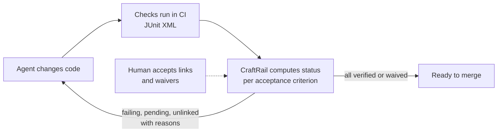

# Product direction

!!! note "Direction, not a shipped feature"
    This page describes where CraftRail is going, as decided in product discovery in November 2026. None of the engine described here is built yet. The rest of this site documents what CraftRail ships today: a repository template with conventions, a workflow, and a structural validator.

## The problem

Teams are building software factories: pipelines where coding agents take work from a specification to a merged change with little human intervention. The agents report their own work as done. A green CI run says the test suite passed. It does not say which acceptance criteria those tests cover, whether any test exercises the real integration, or whether a criterion has no test at all. A factory that trusts the agent's claim ships unverified behavior; a factory that re-checks everything by hand is not a factory.

## What CraftRail will do

CraftRail will give software factories a **deterministic verification loop**. It decides, from evidence produced by real tools, whether each acceptance criterion is satisfied at the current commit, and tells the agent why not when it isn't ([ADR-010](../adr/ADR-010-craftrail-is-the-verification-loop-for-software-factories.md)).

Each status is computed from three inputs ([ADR-002](../adr/ADR-002-evidence-gated-acceptance-is-the-core.md), [ADR-003](../adr/ADR-003-verification-status-is-computed.md)):

- **Verification links**, written next to each acceptance criterion in spec files, naming the checks that count as its evidence. An agent may propose a link; a human accepts it by approving the merge.
- **Evidence**: the results of those checks, read from JUnit XML and stamped with the commit they ran against.
- **Waivers**: a named human's acceptance that a criterion will go unverified, with a reason.

| Who | Decides |
|---|---|
| A human or independent reviewer | Which check counts as evidence for which criterion, and which criteria may go unverified |
| Deterministic rules | Whether the check ran, passed, ran at the current commit, and is at the required level |
| Coding agents | Nothing final. They propose links, write checks, and investigate failures |

Verification status is computed every time. Nobody, human or agent, types it in.

## Where CraftRail fits

CraftRail complements agent workflow tools such as [Matt Pocock's skills](https://github.com/mattpocock/skills) and [Compound Engineering](https://github.com/EveryInc/compound-engineering-plugin). It does not compete with them.

| Concern | Supplied by |
|---|---|
| Brainstorming, planning, specifying | The agent workflow (for example `to-spec`, `ce-brainstorm`, `ce-plan`) |
| Writing code and tests, test-first | The agent workflow (for example `tdd`, `ce-work`) |
| Running checks | The project's test runners and CI |
| Deciding which acceptance criteria are satisfied at this commit | **CraftRail** |
| Review and capturing lessons | The agent workflow and the code host |

A workflow calls CraftRail the way it calls a test runner: through the CLI's exit code and machine-readable output. Nothing in CraftRail's core depends on a particular agent or workflow.

## Decisions so far

| Decision | Record |
|---|---|
| Evidence-gated acceptance is the core. Spec authoring, test running, and architecture or contract checking are left to existing tools | [ADR-002](../adr/ADR-002-evidence-gated-acceptance-is-the-core.md) |
| The acceptance criterion is the unit of verification. There is no separate "Requirement Slice" | [ADR-002](../adr/ADR-002-evidence-gated-acceptance-is-the-core.md) |
| Status is computed; humans accept links and waivers; agents only propose | [ADR-003](../adr/ADR-003-verification-status-is-computed.md) |
| Evidence counts only at the commit it ran against. Skipped results are not evidence, and flaky checks are failing | [ADR-004](../adr/ADR-004-evidence-is-fresh-only-at-its-commit.md) |
| CraftRail ships as a versioned CLI installed with `pipx`. The template becomes an optional starter | [ADR-005](../adr/ADR-005-craftrail-ships-as-an-installable-cli.md) |
| A link or waiver is accepted once it is merged to the protected base branch, through the code host's normal review | [ADR-006](../adr/ADR-006-acceptance-is-recorded-on-the-protected-branch.md) |
| Each acceptance criterion declares a required verification level, so a mocked unit test cannot verify an integration criterion | [ADR-007](../adr/ADR-007-acceptance-criteria-declare-a-required-verification-level.md) |
| Links and waivers live in spec files, not test code. The first evidence format is JUnit XML | [ADR-008](../adr/ADR-008-links-live-in-spec-files-and-evidence-comes-from-junit.md) |
| A failing check outranks a waiver. `unit` < `component` < `integration` < `acceptance`; `contract`, `architecture`, and `non-functional` must match exactly | [ADR-009](../adr/ADR-009-failing-outranks-waived-and-levels-form-one-chain.md) |
| CraftRail is the verification loop for software factories and complements agent workflow tools | [ADR-010](../adr/ADR-010-craftrail-is-the-verification-loop-for-software-factories.md) |
| Stable IDs and feature folders stay as the engine's input; the 9-step lifecycle becomes a reference workflow | [ADR-011](../adr/ADR-011-craftrail-conventions-stay-its-lifecycle-becomes-a-reference.md) |
| Acceptance criteria live only in CraftRail spec files; plans and issues refer to their IDs | [ADR-012](../adr/ADR-012-acceptance-criteria-live-in-craftrail-spec-files.md) |
| The CLI's exit code and JSON output are the integration contract, plus one agent-neutral skill | [ADR-013](../adr/ADR-013-the-cli-output-is-the-integration-contract.md) |
| Pull requests that change links or waivers are flagged (exit code `3`) so a factory routes only those to a human | [ADR-014](../adr/ADR-014-acceptance-changes-are-flagged-for-human-review.md) |

The vocabulary behind these terms is in the repository [glossary](https://github.com/kshitijv97/craft-rail/blob/main/GLOSSARY.md). The engine's core stays standard-library-only Python; dependencies belong in optional adapters.

## The first version

The first version is one command, `craftrail status`. It reads acceptance criteria and accepted links from spec files, reads a JUnit XML report, prints each criterion's status with its reason, and exits non-zero if any criterion is not verified or waived. Run in CI, it becomes the gate. Its requirements and acceptance criteria are in [feature 002](https://github.com/kshitijv97/craft-rail/blob/main/specs/002-evidence-gated-status/spec.md), which is proposed and not yet approved for implementation.

It will not do these things:

- **No change-impact analysis.** It re-verifies everything on every commit. Selecting only the checks a change affects needs a component model, which is deferred.
- **No architecture rules of its own.** Results from tools such as ArchUnit, dependency-cruiser, or import-linter come in as evidence.
- **No agent workflow of its own.** Planning, test-driven development, and review stay with the workflow tools.
- **No Studio dashboard.** The proposed web dashboard is shelved. The identity model and graph export from that proposal remain candidates for the engine's foundation.
- **No separate Verification Specification document.** The plan for verifying a criterion is its required level plus its proposed links.

## How the first version will be judged

For now the first version is tested only on CraftRail's own repository; an external project comes later. It has to show measurable improvement over the current baseline there (Compound Engineering, test-driven development, and CI without CraftRail):

- Criteria found with no evidence.
- Criteria whose only evidence was a check below the required level.
- False "done" claims caught.

Ambiguous requirements, architectural drift, knowledge fragmentation, and change-impact awareness are left to later versions.

## Still open

- The syntax for criteria, links, and waivers in spec files.
- What happens to the hand-typed status column in existing `verification.md` files.
- How the agent-neutral skill is designed and verified.
- What the repository template keeps once the CLI exists.
- Which external project follows dogfooding.
