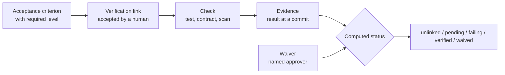

# Product direction

!!! note "Direction, not a shipped feature"
    This page describes where CraftRail is going, as decided in product discovery on 2026-11-17. None of the engine described here is built yet. The rest of this site documents what CraftRail ships today: a repository template with conventions, a workflow, and a structural validator.

## The problem

Coding agents now write much of the code in many projects, and they report their own work as done. A green CI run says the test suite passed. It does not say which requirements those tests cover, whether any test exercises the real integration, or whether a requirement has no test at all. Teams end up trusting the agent's claim, or re-checking everything by hand.

## What CraftRail will do

CraftRail will decide, from evidence produced by real tools, whether each acceptance criterion of a piece of software is satisfied at the current commit. We call this **evidence-gated acceptance** ([ADR-002](../adr/ADR-002-evidence-gated-acceptance-is-the-core.md)).

Authority is split three ways ([ADR-003](../adr/ADR-003-verification-status-is-computed.md)):

| Who | Decides |
|---|---|
| A human or independent reviewer | Which check counts as evidence for which criterion, and which criteria may go unverified (waivers) |
| Deterministic rules | Whether the check ran, passed, ran at the current commit, and is at the required level |
| Coding agents | Nothing final. They propose links, write checks, and investigate failures |

Verification status is computed every time. Nobody, human or agent, types it in.

## Decisions so far

| Decision | Record |
|---|---|
| Evidence-gated acceptance is the core. Spec authoring, test running, and architecture or contract checking are left to existing tools | [ADR-002](../adr/ADR-002-evidence-gated-acceptance-is-the-core.md) |
| The acceptance criterion is the unit of verification. There is no separate "Requirement Slice" | [ADR-002](../adr/ADR-002-evidence-gated-acceptance-is-the-core.md) |
| Status is computed; humans accept links and waivers; agents only propose | [ADR-003](../adr/ADR-003-verification-status-is-computed.md) |
| Evidence counts only at the commit it ran against. Skipped results are not evidence, and flaky checks are failing | [ADR-004](../adr/ADR-004-evidence-is-fresh-only-at-its-commit.md) |
| CraftRail ships as a versioned CLI installed with `pipx`. The template becomes an optional starter | [ADR-005](../adr/ADR-005-craftrail-ships-as-an-installable-cli.md) |
| A link or waiver is accepted once it is merged to the protected base branch, through the code host's normal review | [ADR-006](../adr/ADR-006-acceptance-is-recorded-on-the-protected-branch.md) |
| Each acceptance criterion declares a required verification level, so a mocked unit test cannot verify an integration criterion | [ADR-007](../adr/ADR-007-acceptance-criteria-declare-a-required-verification-level.md) |

The vocabulary behind these terms is in the repository [glossary](https://github.com/kshitijv97/craft-rail/blob/main/GLOSSARY.md).

## What the first version will not do

- **No change-impact analysis.** The first version re-verifies everything on every commit. Selecting only the checks a change affects needs a component model, which is deferred.
- **No architecture rules of its own.** Results from tools such as ArchUnit, dependency-cruiser, or import-linter come in as evidence.
- **No Studio dashboard.** The proposed web dashboard is shelved. The identity model and graph export from that proposal remain candidates for the engine's foundation.
- **No separate Verification Specification document.** The plan for verifying a criterion is its required level plus its proposed links.

## How the first version will be judged

The first version has to show measurable improvement over a baseline of Compound Engineering, test-driven development, and CI on the same project, on these problems:

- Traceability: every criterion can be traced to the checks that verify it.
- Test adequacy and integration: criteria that need an integration check cannot be satisfied by unit tests alone.
- Completion claims: "done" means computed status, not an agent's report.

Ambiguous requirements, architectural drift, knowledge fragmentation, and change-impact awareness are left to later versions.

## Still open

These questions are not decided yet:

- Where verification links and waivers are stored: in spec files or as annotations in test code.
- Which result formats CraftRail reads first (JUnit XML is the likely start).
- Whether the core keeps its standard-library-only rule now that it ships as a package.
- How a waiver interacts with a check that is failing on the same criterion.
- How a check declares its verification level, and whether the levels are strictly ordered.
- Which real project the first version is tested against, and how the baseline comparison is measured.
