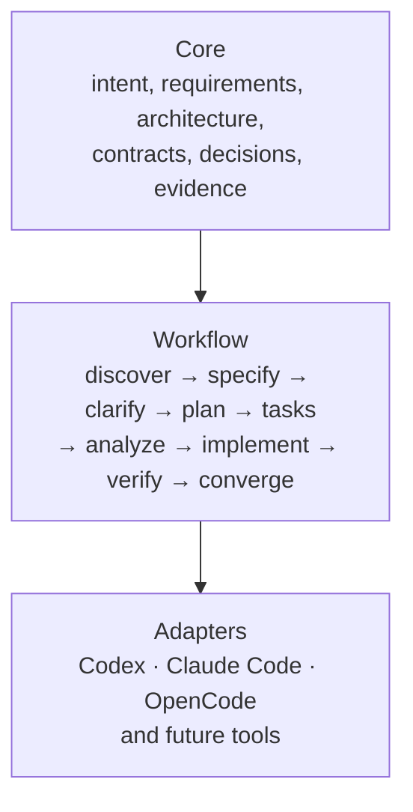

# CraftRail developer documentation

**Guardrails for agent-driven development.**

CraftRail helps a development team keep product intent, requirements, architecture, decisions, implementation work, and verification evidence together in Git. The framework owns the engineering process; the coding agent is replaceable.

## Start with the problem

An agent can act on the code it sees, but chat history is temporary and a codebase rarely reveals every business rule or architectural constraint. Teams consequently repeat discovery, infer requirements differently, and lose the reasoning behind important choices. CraftRail gives that information durable names and paths, then connects it to the tests and reviews that show whether a change met its intent.

CraftRail does not guarantee an agent's answer is correct. It makes the assumptions, decisions, changes, and evidence easier for people to inspect.

## Choose a path

| If you want to… | Read |
|---|---|
| Understand the model and why the repository is split into layers | [Overview and architecture](framework/overview.md) |
| Start a new repository or add conventions to an existing one | [Quickstart](framework/quickstart.md) |
| Write a testable requirement or feature specification | [Requirements guide](framework/requirements-writing-guide.md), [feature specification guide](framework/feature-specification-guide.md) |
| Decide which diagrams or decision records to maintain | [Architecture guide](framework/architecture-documentation-guide.md), [Mermaid guide](framework/diagrams-guide.md), [ADR guide](framework/adr-guide.md) |
| Plan and verify a feature | [Workflow](framework/workflow.md), [task guide](framework/tasks-guide.md), [traceability guide](framework/traceability-and-verification.md) |
| Use an AI coding agent without coupling the project to its vendor | [Compatibility guide](framework/agent-compatibility.md), [neutral prompts](framework/workflow-prompts.md) |

## The three layers

Core artifacts and workflow prompts are plain, versioned files. Adapters only help a coding agent locate those files or map to optional tool features. They do not own project requirements. [Read why this split matters](framework/overview.md).

## A practical first run

1. Write down who the project serves, the problem, expected outcomes, and non-goals.
2. Create or adopt one feature specification and mark unresolved questions explicitly.
3. Approve the intent before asking an agent to plan implementation.
4. Link work items to requirements and acceptance criteria.
5. Test the behavior, record evidence, and update the docs to describe the approved shipped state.

See the [account recovery example](examples/sample-feature-walkthrough.md) for a full artifact chain. It is illustrative and explicitly not a production security design.

## Repository and source of truth

This site renders the repository's existing Markdown under `docs/`; it does not copy documents into a separate website source tree. The root `AGENTS.md` is the canonical shared agent guidance. `CLAUDE.md` imports it; OpenCode reads `AGENTS.md` directly. See the [compatibility matrix](framework/agent-compatibility.md).

For implementation details, contribution checks, and release decisions, start at the repository's `README.md` at the project root. The site generator is a presentation layer: replace it without changing the canonical content if project needs change.
