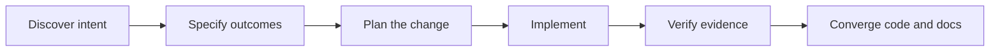

A practical engineering framework for teams using coding agents

<h1>Give coding agents the context your code cannot</h1>

Keep requirements, architecture, decisions, and verification beside the code they guide. CraftRail gives people and coding agents one shared, reviewable way to move from intent to working software.

<a class="cr-button cr-button-primary" href="https://github.com/kshitijv97/craft-rail">Use the GitHub template</a> <a class="cr-button cr-button-secondary" href="adoption/">Explore the adoption guide</a>

Open formats. Your repository. The coding agent is replaceable.

## Keep the important context where the work happens

Coding agents can move quickly, but project intent is easy to lose between conversations, contributors, and releases. CraftRail gives teams a durable place to explain what they are building, why key choices were made, and how they will tell whether a change works.

That context lives in ordinary files in your repository. It can be reviewed in a pull request, versioned with the code, and used by engineers and agents alike.

01 · Make intent explicit

<h3>Turn assumptions into shared requirements</h3>

Record outcomes, constraints, and acceptance criteria before implementation. Give important requirements stable references so plans and tests can point back to them.

02 · Keep architecture legible

<h3>Preserve the reasoning behind decisions</h3>

Use lightweight architecture views, decision records, and contracts to give contributors a map of the system and the boundaries changes should respect.

03 · Show how work is verified

<h3>Connect the change to evidence</h3>

Carry acceptance criteria through plans, tasks, tests, review, and verification notes. Make it easier to see what was checked and what remains uncertain.

## A workflow that belongs to your team

CraftRail provides a path from discovery through convergence. Scale it to the change: a small fix can stay small, while high-impact work can use explicit specifications, plans, and verification records.

The workflow is written as shared project guidance and ordinary prompts. It does not depend on one model provider, proprietary command syntax, or a hosted CraftRail service. Keep your existing tools and delivery practices; adopt the conventions that improve clarity.

## Built to move with your project

### Use the coding agent you prefer

The project keeps a single canonical `AGENTS.md` and small adapters where a tool needs them. Codex, Claude Code, and OpenCode can work from the same project knowledge. Switching agents does not require migrating requirements or rewriting engineering conventions. See the [compatibility guide](framework/agent-compatibility.md) for documented support and verification status.

### Start fresh or adopt incrementally

Create a repository from the [GitHub template](framework/github-template-usage.md), or bring selected conventions into an existing project. CraftRail can sit alongside your current source of truth and delivery process while you decide what is useful.

### Keep the source portable

Core guidance and examples use Markdown, Mermaid, YAML, and JSON. The small initializer and structural validator use Python's standard library. There is no required SaaS account, agent subscription, runtime service, or proprietary project format.

## A useful framework, not an automatic guarantee

CraftRail helps make project context and verification easier to inspect. It does not guarantee generated code is correct, replace engineering judgment, tests, security review, or code review, or automatically approve a specification. Teams remain responsible for deciding what to build and whether the evidence is sufficient.

## Start with one project

Use the starter repository, replace the illustrative project content with your own, and try the workflow on one meaningful feature. Keep the conventions that help your team and adapt the rest.

<a class="cr-button cr-button-primary" href="https://github.com/kshitijv97/craft-rail">Get CraftRail on GitHub</a> <a class="cr-button cr-button-secondary" href="adoption/">Read the adoption docs</a> <a class="cr-text-link" href="implementation/">Explore the technical implementation →</a>

---

The framework owns the engineering process. The coding agent is replaceable.

