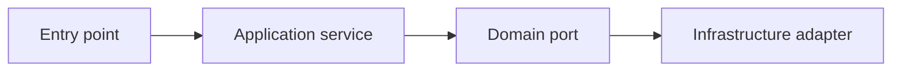

# Component view

**Abstraction:** important internal responsibilities
**Scope:** [container or module]
**Last reviewed:** YYYY-MM-DD

Replace the generic view; explain boundaries and dependencies that matter to change.
