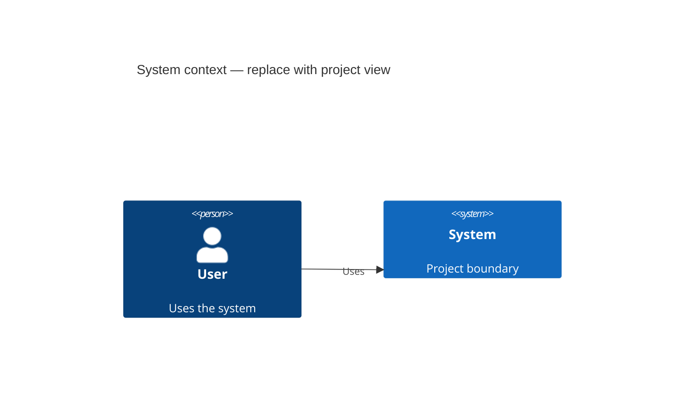

# System context

**Abstraction:** system and external actors
**Scope:** [system]
**Last reviewed:** YYYY-MM-DD

Explain actors, external systems, and the boundary. Replace the starter diagram with repository-specific facts.
