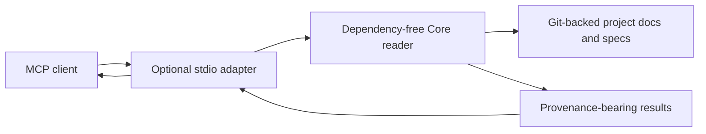

# Technical plan: 001 Local read-only knowledge retrieval

- **Status:** proposed
- **Related spec:** [spec.md](spec.md)

## Proposed solution and alternatives

Add a dependency-free Core reader that indexes the existing artifact paths in memory, parses only the metadata needed for IDs, titles, status, and relationships, and returns source-backed records. Expose that reader through a separate optional MCP adapter using the official Python SDK and stdio. Provide a thin Claude Code plugin adapter that starts the same server. Do not add a persistent index until measurements show repository-scale search needs it.

Alternatives considered: keep only the existing prompt workflow (does not satisfy programmatic retrieval); add SQLite FTS immediately (adds migration and stale-index concerns before there is retrieval evidence); introduce embeddings (premature without an evaluation set); implement the MCP server in TypeScript (adds a second runtime despite the existing Python tooling).

## Impacted components and interfaces

- New provider-independent artifact reader and search/context assembly interfaces.
- New optional MCP adapter with read-only tool definitions.
- New Claude Code plugin directory with manifest, workflow skill(s), and MCP configuration; no hooks or specialist agents in this slice.
- Feature spec and documentation website navigation and installation guide.
- Existing scripts and template workflows remain unchanged except where shared validation logic can be reused without provider dependencies.

## Data and migration

No canonical data migration. Read existing `docs/project/`, `specs/`, and ADR conventions. The roadmap's illustrative `.craftrail/` store is not adopted. No index is persisted in the first slice.

## Diagrams

Scope: local read-only retrieval. Last reviewed: 2026-11-16.

## Security and trust boundaries

Resolve the configured root once; reject file paths outside it after resolving symlinks. Tool arguments accept artifact identifiers and search filters, not arbitrary filesystem paths. Return matched text as untrusted content with source and status metadata. Keep writes and network transports out of this server. Keep protocol output on stdout and logs on stderr.

## Errors, retries, idempotency, and consistency

Operations are read-only and deterministic for a fixed worktree. Invalid identifiers, unavailable roots, parse warnings, and empty results have distinct outcomes. Since there is no persistent index, worktree edits are visible on the next call.

## Operations and rollout

The core reader remains runnable with the repository's supported Python baseline. The MCP adapter is optional and requires Python 3.11+ under the current official SDK. The Claude adapter invokes the local optional server; installation and project-root behavior must be documented. No deployment or hosted service is needed.

## Test strategy

Link tests to `AC-001`–`AC-005`: parser/search unit cases, path and symlink boundary cases, SDK-level in-process tool calls, stdio client handshake, optional-dependency isolation, and plugin manifest validation. These are planned verification methods; none has been run yet.

## Open decisions

- Confirm the supported artifact path patterns and metadata fields from existing docs before implementing parsers.
- Confirm the Claude plugin's configured repository-root behavior against current official documentation and direct host testing.
- Keep the optional SDK version pinned when packaging; validate it with the selected Python version.
