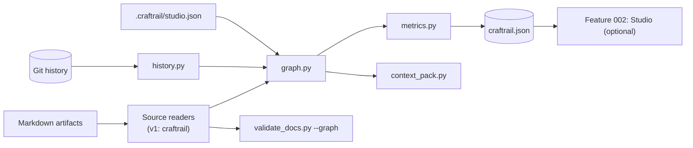
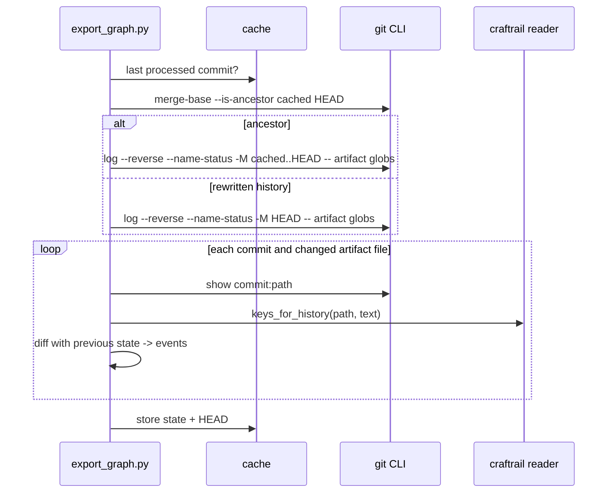

# Technical plan: 001 Machine-readable conventions and graph export

- **Status:** proposed
- **Related spec:** [spec.md](spec.md)
- **Decision:** [ADR-001](../../docs/decisions/ADR-001-craftrail-studio-git-native-static-studio.md)

## Proposed solution and alternatives

A standard-library package, `scripts/craftrail_core/`, holds all parsing and graph logic. Thin CLIs and the existing validator call it. Alternatives are recorded in ADR-001.



## Impacted components and interfaces

```text
scripts/
  craftrail_core/
    __init__.py
    frontmatter.py     # restricted YAML profile parser; line-accurate errors; serializer used by migration
    legacy_meta.py     # "- **Key:** value" block reader
    md_tables.py       # GFM table tokenizer (escaped pipes, inline code, alignment rows)
    declarations.py    # declaration bullets in spec.md
    items.py           # Item, Link, Event, Diagnostic dataclasses; canonical keys
    resolve.py         # reference resolution and feature-local scoping
    statuses.py        # vocabularies; note parsing ("verified (illustrative)")
    links.py           # link extraction rules
    readers/
      __init__.py      # SourceReader protocol + registry
      craftrail.py     # v1 reader
    history.py         # git CLI mining, rename following, cache, ancestry check
    metrics.py         # pure functions over items + events
    config.py          # .craftrail/studio.json + defaults
    context.py         # context pack algorithm
    graph.py           # assembly + deterministic JSON serialization
  export_graph.py      # CLI
  migrate_frontmatter.py
  context_pack.py
  validate_docs.py     # gains --graph; existing behaviour unchanged without it
  new_feature.py       # front-matter output; global requirement IDs; --local-requirement-ids
templates/feature/*.md # gain front-matter
tests/
  fixtures/make_fixture_repo.py  # deterministic git repos (fixed GIT_AUTHOR_DATE / GIT_COMMITTER_DATE)
  fixtures/shared/               # also consumed by feature 002's TypeScript tests
  test_frontmatter.py test_legacy_meta.py test_tables.py test_identity.py test_statuses.py
  test_links.py test_export.py test_history.py test_metrics.py test_config.py
  test_context.py test_readers.py test_migrate.py test_new_feature_ids.py
.gitignore             # craftrail.json, .craftrail/cache/
```

Interface compatibility: `validate_docs.py` without `--graph` behaves exactly as before (existing tests must pass unchanged). `new_feature.py` changes default numbering, with a flag for the old behaviour.

## Data and migration

1. Ship parsers with legacy support. Graph mode is opt-in.
2. Migrate this repository and its templates with `migrate_frontmatter.py`. Illustrative content under `specs/000-example-feature/` and `docs/project/` stays exempt.
3. Next minor release: graph validation becomes default in CI templates; legacy-only metadata stays a warning.
4. Two minor releases later: legacy-only metadata becomes an error under `--strict`.

Rollback: remove the new scripts and the `--graph` flag. Front-matter remains valid, renderable Markdown.

## Diagrams

The component flow is above. History mining, per commit:



## Security and trust boundaries

Read-only filesystem access and read-only `git` subcommands. No network, no subprocess other than `git` with an argument list (no shell). Output paths are repository-relative. Author emails are never requested (`--format` uses `%an` only).

## Errors, retries, idempotency, and consistency

- Parse errors are per file and become diagnostics.
- `git` failures disable history with a diagnostic, and export continues.
- Output is deterministic, so export is idempotent.
- The cache is rebuilt on ancestry mismatch or cache-version change.

## Operations and rollout

| Milestone | Content | Exit |
|---|---|---|
| M1 Conventions | front-matter, legacy reader, tables, identity, statuses, `--graph`, migration, templates, `new_feature.py` | `AC-001`–`AC-007`, `AC-018` |
| M2 Export | readers, links, history, cache, metrics, config, diagnostics, determinism, context packs, benchmark | `AC-008`–`AC-017`, `AC-019` |

Docs:
- new `docs/framework/machine-readable-conventions.md` (front-matter, tables, identity, statuses, export, metrics definitions, context packs);
- updates to `concepts.md`, `validation.md`, `feature-specification-guide.md` and `ecosystem-comparison.md` (positioning per ADR-001);
- `zensical.toml` nav;
- CHANGELOG.

## Test strategy

| Layer | Tooling | ACs |
|---|---|---|
| Unit (stdlib `unittest`, all supported Python versions) | parsers, statuses, identity, links, metrics, config, context, readers | `AC-001`, `AC-002`, `AC-004`–`AC-007`, `AC-009`, `AC-012`, `AC-015`–`AC-017` |
| Integration (real `git`, generated fixture repos) | history, renames, cache, rebase, shallow clone, determinism, dirty flag, malformed files | `AC-010`, `AC-011`, `AC-013`, `AC-014` |
| Golden files | export, context packs, migration diffs | `AC-003`, `AC-008`, `AC-015` |
| Schema checks (dev env: `jsonschema`) | export validates against the graph schema; front-matter samples against the front-matter schema | `AC-008`, `AC-017` |
| Benchmark (CI, generated 2,000-item / 1,500-commit repo) | `NFR-002` | `AC-019` |
| Coverage (pytest-cov in dev env) | `NFR-003` | `AC-019` |

## Open decisions

1. Contracts location and ADR location (spec questions).
2. Whether `craftrail.json` should be uploaded as a CI artifact by the default quality workflow.
