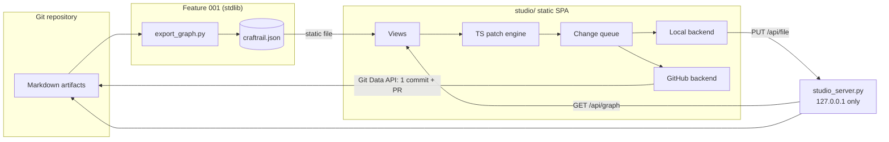
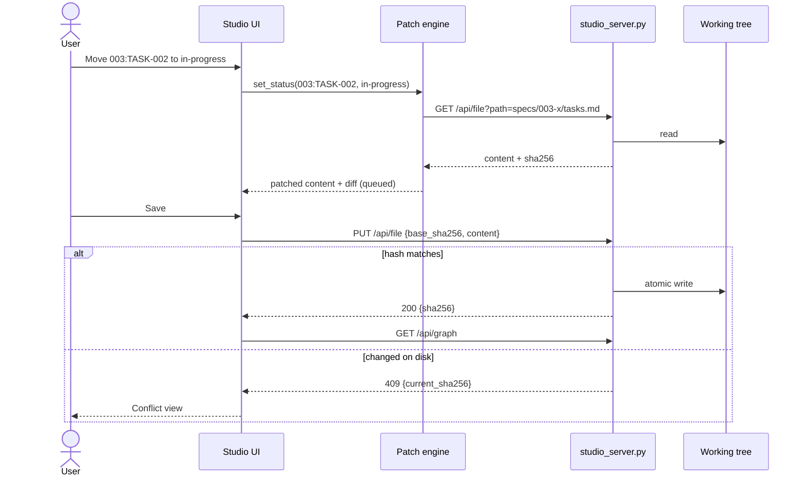

# Technical plan: 002 CraftRail Studio

- **Status:** proposed
- **Related spec:** [spec.md](spec.md)
- **Decision:** [ADR-001](../../docs/decisions/ADR-001-craftrail-studio-git-native-static-studio.md)
- **Depends on:** [Feature 001 plan](../001-machine-readable-conventions-and-graph-export/plan.md)

## Proposed solution and alternatives

Reads are implemented in Python (feature 001's exporter) so CI and agents can use them without Node. Writes are implemented once, in TypeScript (the patch engine), because only the UI edits. The local server is a thin, safe file gateway. Shared fixtures keep reader and writer consistent: `export(apply_patch(file)) == expected`.



Alternatives are in ADR-001.

## Impacted components and interfaces

```text
scripts/studio_server.py          # stdlib http.server; loopback; token; globs
studio/
  package.json  pnpm-lock.yaml  vite.config.ts  tsconfig.json  biome.json
  index.html                      # CSP meta
  src/
    data/       loadGraph.ts, types.gen.ts (generated from graph schema; CI staleness check)
    views/      Overview, Board, Traceability, ItemDetail, Metrics, Decisions, Search
    patch/      frontmatter.ts, tables.ts, declarations.ts, ops.ts, diff.ts
    backends/   Backend.ts (interface), local.ts, github.ts
    context/    pack.ts (parity with context_pack.py), prompts.ts
    validate/   schema.ts (Ajv), rules.ts
  tests/        unit (Vitest), e2e (Playwright + axe), msw handlers
tests/test_server.py              # Python tests for studio_server.py
.github/workflows/studio.yml      # optional template
```

### Stack (OSI licences, pinned by `pnpm-lock.yaml`)

| Concern | Choice | Why |
|---|---|---|
| Build | Vite, TypeScript strict | Static output, base-path aware |
| UI | React | Ecosystem for graph and accessible components |
| Graph | `@xyflow/react` + `dagre` | MIT; handles 1,000+ nodes; keyboard support |
| Charts | uPlot | About 50 KB; fits the bundle budget |
| Routing | `wouter` with hash location | Works under any sub-path without server rewrites |
| State | Zustand | Small store for graph, filters and queue |
| Markdown | `markdown-it` + DOMPurify | Sanitised rendering |
| Validation | Ajv (Draft 2020-12) | Same contracts as feature 001 |
| Diff | `diff` (jsdiff) | Change-queue previews |
| Lint/format | Biome | One fast tool |
| Tests | Vitest, Testing Library, Playwright, `@axe-core/playwright`, MSW | Unit, e2e, accessibility, GitHub mocking |

### Local server API

All `/api` endpoints require header `X-CraftRail-Token` and matching `Host`/`Origin` (`http://127.0.0.1:<port>`).

| Method | Path | Request | Response | Errors |
|---|---|---|---|---|
| GET | `/` and assets | — | built app from `--app-dir` (default `studio/dist`) | 404 with build instructions if missing |
| GET | `/api/health` | — | `{ok, repo_root_name, git}` | — |
| GET | `/api/graph` | `?history=0\|1` | fresh export (cached by HEAD + dirty-file hashes) | 500 with diagnostics |
| GET | `/api/file` | `?path=<repo-relative>` | `{path, sha256, content}` | 403 outside globs; 404 missing |
| PUT | `/api/file` | `{path, base_sha256, content}` (at most 2 MB) | `{path, sha256}` | 403 outside globs or symlink; 409 `{current_sha256}`; 413 |

Startup prints `Studio: http://127.0.0.1:<port>/#token=<token>`. Writes are atomic (temp file + `os.replace`) and keep the file's newline style.

### GitHub backend flow

1. Resolve the default branch and base commit.
2. For each queued file, compare the current blob SHA at base with the SHA seen at load time. On mismatch, show the conflict view.
3. `POST /git/blobs` (each file) → `POST /git/trees` (with `base_tree`) → `POST /git/commits` → `POST /git/refs` (`refs/heads/studio/<YYYYMMDD>-<slug>`).
4. `POST /pulls` with a body listing every operation and its item keys. Approval changes force PR mode and the `approval` label.
5. Errors:
   - 401/403: show the scopes message;
   - 404: repository access;
   - 422 on an existing ref: add a suffix;
   - secondary rate limit: show retry-after.

## Data and migration

There is no persistent data of its own; Studio only edits repository files. Studio refuses graph exports with an unknown major `schema_version`. Removing `studio/` and `studio_server.py` fully rolls back.

## Diagrams

Edit sequence (local mode):



## Security and trust boundaries

| Boundary | Threat | Control |
|---|---|---|
| Browser ↔ local server | Other local processes or pages (DNS rebinding, CSRF) | Loopback bind; `Host`/`Origin` checks; token header from URL fragment; no CORS; no cookies |
| Local server ↔ filesystem | Traversal; writing code | Repo-relative paths; `realpath` inside root; symlink rejection; glob allow-list; size limit |
| Studio ↔ GitHub | Token theft; over-privilege | Fine-grained single-repo PAT; minimal scopes; memory-only by default; CSP `connect-src` |
| Rendered Markdown | XSS from repo content | `markdown-it` `html: false` + DOMPurify |
| Copied prompts | Prompt injection into agents | Packs are data with source paths; no automatic execution |

## Errors, retries, idempotency, and consistency

- Patch application is deterministic.
- Saves use optimistic concurrency. Local writes are atomic. GitHub writes one commit per save, and retries follow the partial-save rule in the spec.
- No automatic retry loops on API errors.

## Operations and rollout

| Milestone | Content | Exit |
|---|---|---|
| M3 Read-only Studio | scaffold, server read endpoints, shell, views, search/URL, metrics, accessibility | `AC-001`–`AC-006`, `AC-015` |
| M4 Local editing | patch engine, queue, validation, server `PUT`, conflicts, approval guard, edit flows | `AC-007`, `AC-008`, `AC-010`–`AC-012` |
| M5 GitHub editing and prompts | GitHub backend, copy prompt with TS pack parity | `AC-009`, `AC-013` |
| M6 Hosting and release | `studio.yml`, base path, CSP, budgets, docs, release asset | `AC-014`, `AC-016` |

Docs: new `docs/framework/studio.md` (local mode, hosting, editing, metrics, limits, positioning), nav entry, CHANGELOG.

## Test strategy

| Layer | Tooling | ACs |
|---|---|---|
| Python unit/integration | `unittest` for `studio_server.py` (security matrix, atomic writes, newline preservation) | `AC-008` |
| TS unit | Vitest + Testing Library: patch engine (100% branch), validation, stores, components | `AC-007`, `AC-011` |
| Cross-language contract | feature 001's `tests/fixtures/shared/`: patched output re-exported by Python; TS pack equals Python pack | `AC-007`, `AC-013` |
| E2E | Playwright against `studio_server.py` serving a fixture repo copy | `AC-001`–`AC-006`, `AC-008`, `AC-010`–`AC-013`, `AC-015` |
| GitHub mocked | MSW handlers built from GitHub REST docs | `AC-009` |
| Accessibility | `@axe-core/playwright` on every view + keyboard-only journey | `AC-016` |
| Budgets | gzip bundle check; manual 1,000-node fps recording | `AC-016` |
| Workflow | actionlint; run `studio.yml` in a scratch repository | `AC-014` |

CI jobs:
1. `studio`: `pnpm install --frozen-lockfile`, Biome, `tsc --noEmit`, Vitest with coverage, build, bundle budget, generated-types staleness check;
2. `studio-e2e`: Playwright on three browser engines, plus axe.

## Open decisions

1. Release packaging of the prebuilt app (spec question).
2. Whether the first follow-up is the OpenSpec source reader (ADR-001) or the GitHub Projects mirror.
